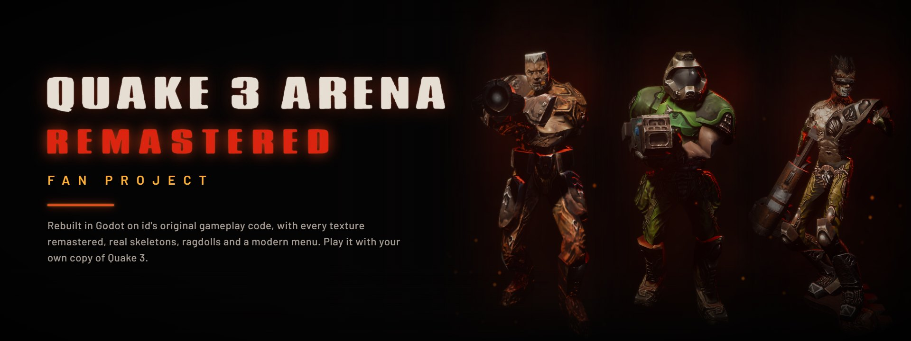

# Quake 3 Arena Remastered: Fan Project

**The 1999 arena shooter, rebuilt for today without touching what made it great.**

Rocket jumps, strafe jumping, rail duels, and Sarge, Xaero and the rest of the roster, now with modern characters, lighting, effects, menus and online features. It's an unofficial, non-commercial fan project. You need your own copy of Quake III Arena on Steam to play.

### Menus

| | |
|---|---|
| 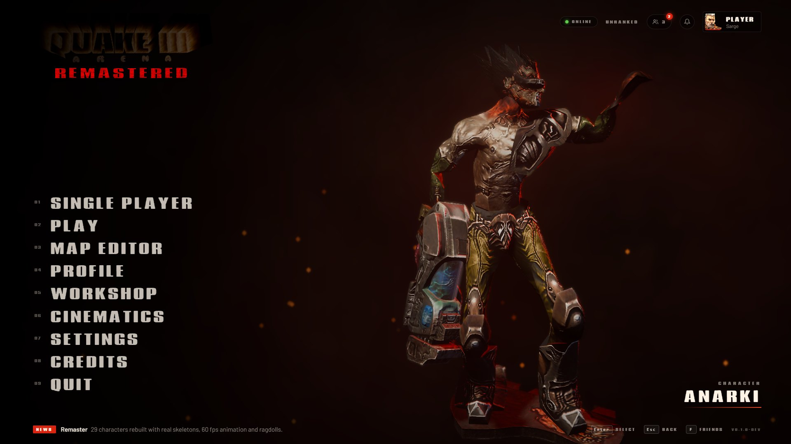 | 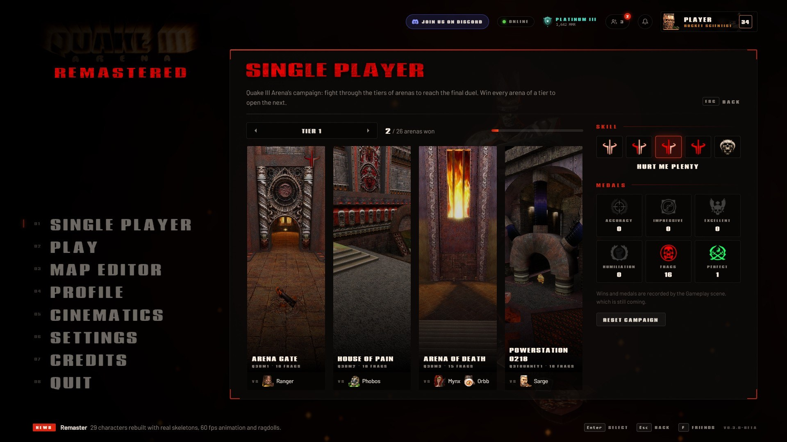 |
| **Main menu:** a fighter or item turning in a smoky void, with Quake 3's own menu sounds | **Single player:** id's campaign, tier by tier, with skill levels and medals |
| 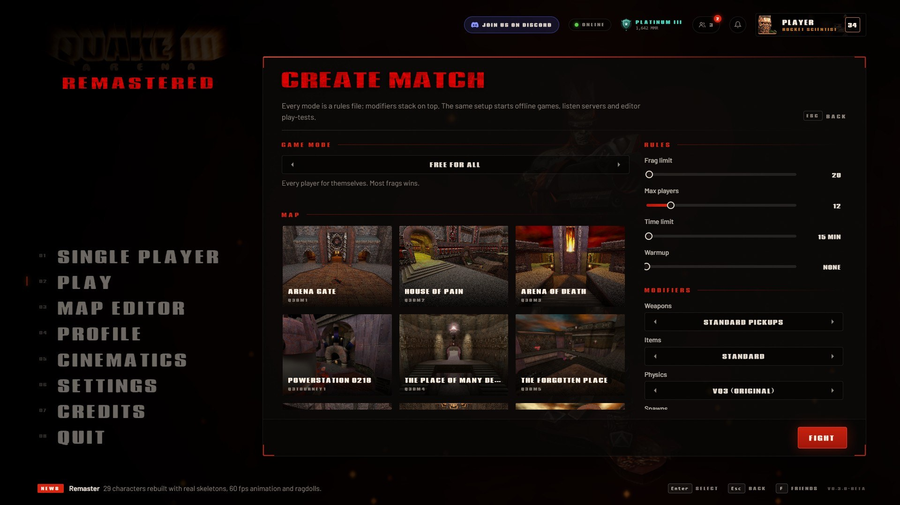 | 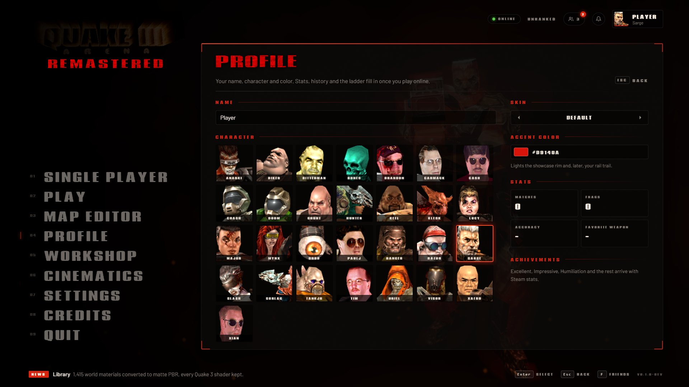 |
| **Create match:** every mode, map and rule, with modifiers on top | **Profile:** name, character, skin and accent color |

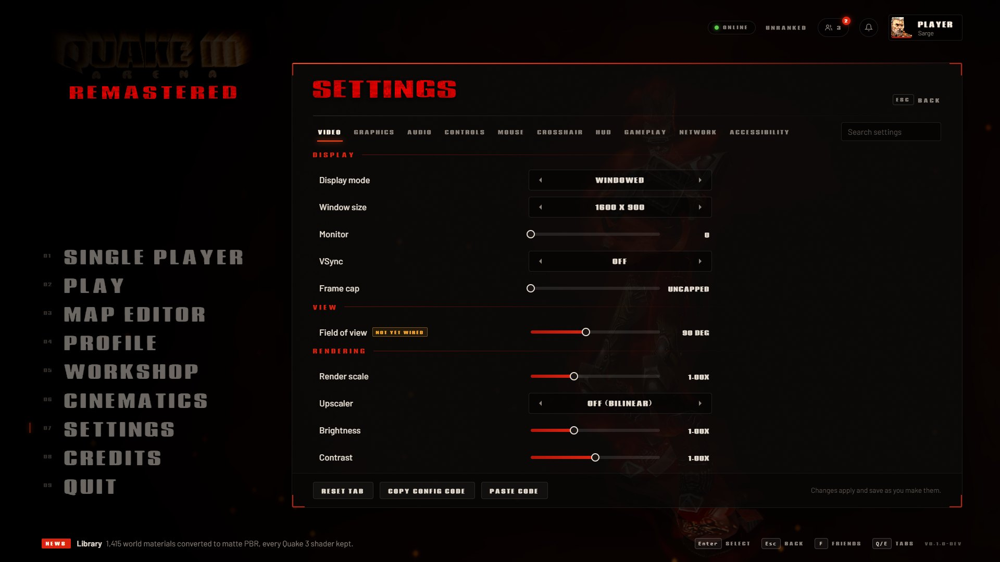

### In game

| | |
|---|---|
| 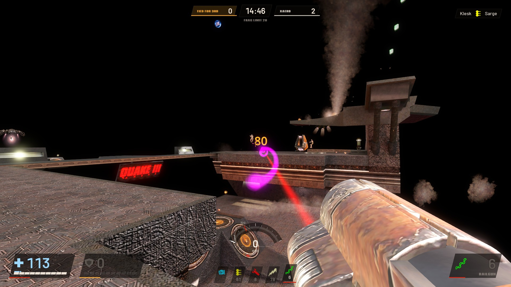 | 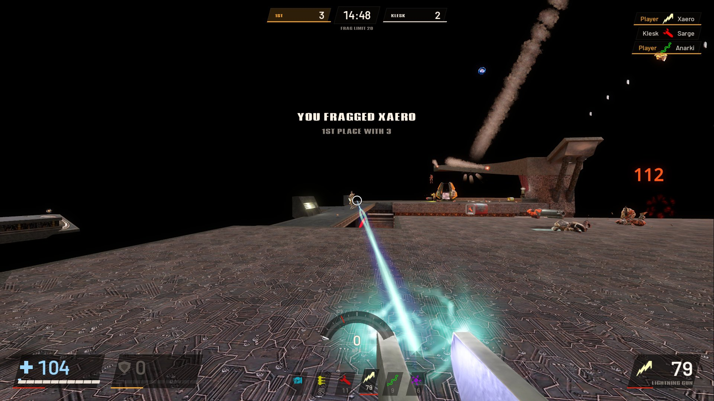 |
| **The Longest Yard** (q3dm17), railgun | **The Longest Yard**, lightning gun |
| 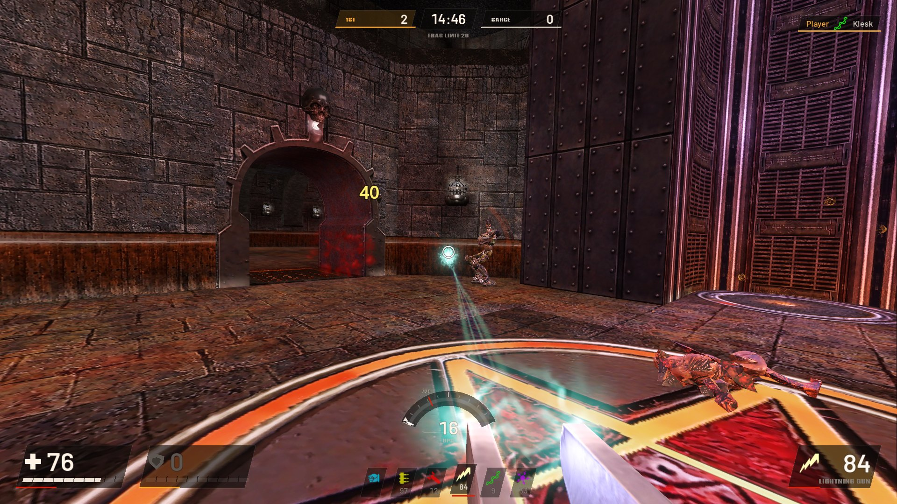 | 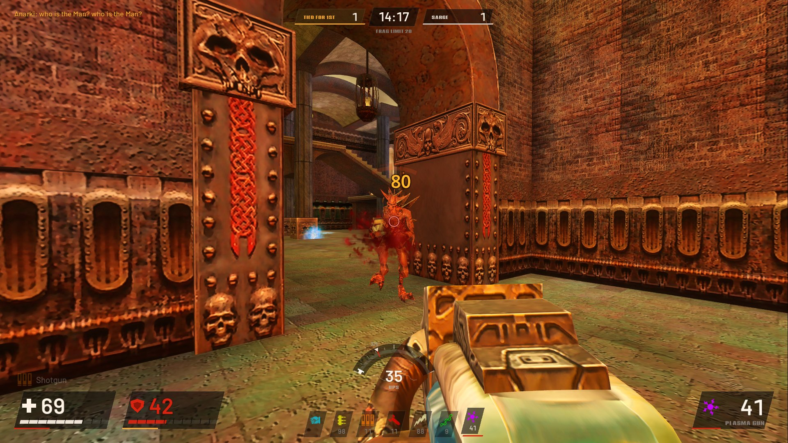 |
| **The Campgrounds** (q3dm6) | **Temple of Retribution** (q3dm7) |
| 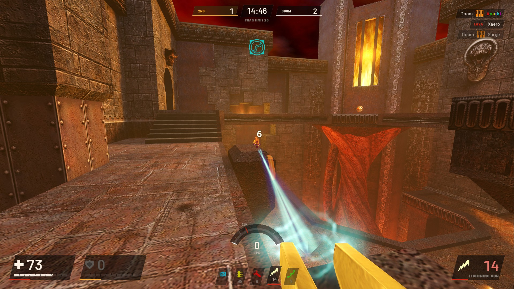 | 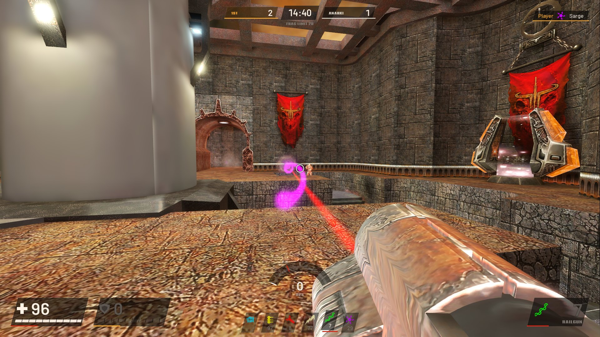 |
| **Lost World** (q3dm13) | **The Proving Grounds** (q3tourney2) |

All screenshots are real matches against id's bots, captured in the engine at 1920x1080 (`godot/tests/screenshots.tscn`). Key art and a social preview card are in [docs/promo](docs/promo).

## The same game, down to the frame

Most remakes copy the original from memory. This one runs id Software's own game code.

- **The original engine code runs every match.** Movement, weapons, items, damage and the rules come straight from Quake III Arena's released source, so strafe jumps, rocket jumps and circle jumps behave exactly as they did.
- **Checked line by line against the 1999 release.** The modern open-source port of Quake 3 changed a few things over the years. Every change that affected play was found and put back the way id shipped it.
- **The original bots, personalities and all.** Sarge, Xaero, Klesk, Doom and the rest find their way around the original maps the same way, pick fights the same way, and still talk trash in chat.
- **The classic 125 Hz physics.** Movement runs at the fixed rate competitive players have always used, so jump heights and speeds match.

## What's new

| | Quake III Arena (1999) | Remastered |
|---|---|---|
| **Characters** | Low-poly models with stiff, frame-by-frame animation | All 29 fighters rebuilt with real skeletons, smooth 60 fps animation and much finer meshes |
| **Deaths** | Canned death animations | Physics ragdolls that react to the hit that killed them, then burn away |
| **Textures** | Hand-painted 1999 textures | Every surface in the game remade as a modern matte material that reacts to light, with less of the repeating-tile look |
| **Lighting** | 1999 lightmaps | All 35 original maps relit with modern global illumination |
| **Effects** | Sprite explosions and beams | Remade explosions, smoke, rail trails, lightning, blood and impacts, using the original effect timings |
| **Movies** | Low-resolution intro and tier movies | All 10 cinematics upscaled |
| **Main menu** | Static menu screens | A cinematic menu: one fighter or weapon floating in a dark, smoky void while the camera drifts, with the original menu sounds |
| **HUD** | Fixed classic HUD | A Quake Live-style HUD with four presets, a speedometer that shows your strafe-jump gain, a kill feed, damage direction arcs and award medals |
| **Crosshair** | Pick one of ten | A full crosshair editor with per-weapon crosshairs and shareable codes, previewed live in the match behind it |
| **Settings** | Basic options, console variables | A full settings menu with search, live preview and shareable config codes |
| **Online** | Server browser, IP addresses | Friends, parties and presence, with no accounts to sign up for |

## In the game now

- **Single player:** the original campaign, from Training through six tiers to the final duel with Xaero, with medals, skill levels and the tier movies.
- **Offline vs bots and training:** any original map, any mode, any bot lineup.
- **All 35 original maps,** relit, from q3dm0 to the pro duel maps.
- **Game modes:** Free For All, Tournament (Duel), Team Deathmatch and Capture the Flag.
- **Pause menu:** change any setting or edit your crosshair without leaving the match.
- **Friends and parties:**
  - Add friends with a short friend code, and see who's online and what they're playing.
  - Form a party of up to 8 and chat. No email, password or account needed.
- **Controller support** throughout the menus.

## On the way

- **Online matches without paying for servers:** anyone can host from their own PC, and one match browser shows every match. Optional dedicated servers. Lobbies vote-kick troublemakers instead of relying on anti-cheat software.
- **More modes:** Clan Arena, Freeze Tag and Instagib as optional rule sets.
- **Ranked play:** a duel queue with an Elo ladder, seasons and tiers named after Quake 3's skill levels.
- **Player cards:** a customizable card with about 380 Quake 3-themed banners, emblems, frames and titles, earned through XP and 89 achievements. Progression is cosmetic only and never changes the game.
- **A built-in map editor:** build arenas inside the game, import the original maps, play-test instantly, and edit together with friends.
- **A Workshop** for sharing maps, skins and mods.

## What stays the same

Some things shouldn't change, so they don't:

- Movement, weapon damage, fire rates, item timers and spawn rules.
- The original announcer and soundtrack.
- Everything the original game gave everyone for free, like every character and skin, colored names and rail colors. Unlocks are cosmetic extras on top.

## Playing it

There's no ready-made download yet. The game is built from this source code and the Quake III Arena files on your PC; [DEVELOPMENT.md](DEVELOPMENT.md) walks through it.

**You'll need:**

- Windows.
- Quake III Arena on Steam. The remaster reads your own copy; none of the game's files are included here.

## For developers

[DEVELOPMENT.md](DEVELOPMENT.md) covers how everything is built: the asset tools, the Godot project, the game code, tests and folder layout. [PLAN.md](PLAN.md) is the roadmap and design.

## License

The code in this repository is licensed under the GNU General Public License v2.0 (`LICENSE`), the license of id Software's Quake III Arena source release and ioquake3, whose game code this project runs.

The license covers code only. Quake III Arena's assets (models, textures, maps, sounds, music) belong to id Software and aren't in this repository; you need your own copy of Quake 3. This is an unofficial fan project, not affiliated with or endorsed by id Software, Bethesda or ZeniMax. Quake is a trademark of ZeniMax Media.
